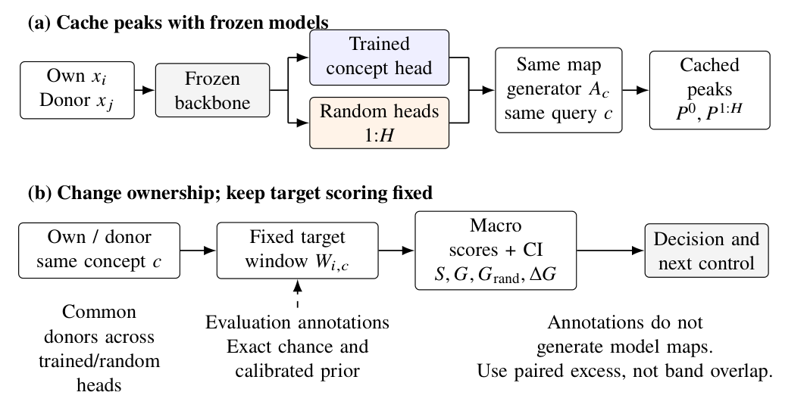
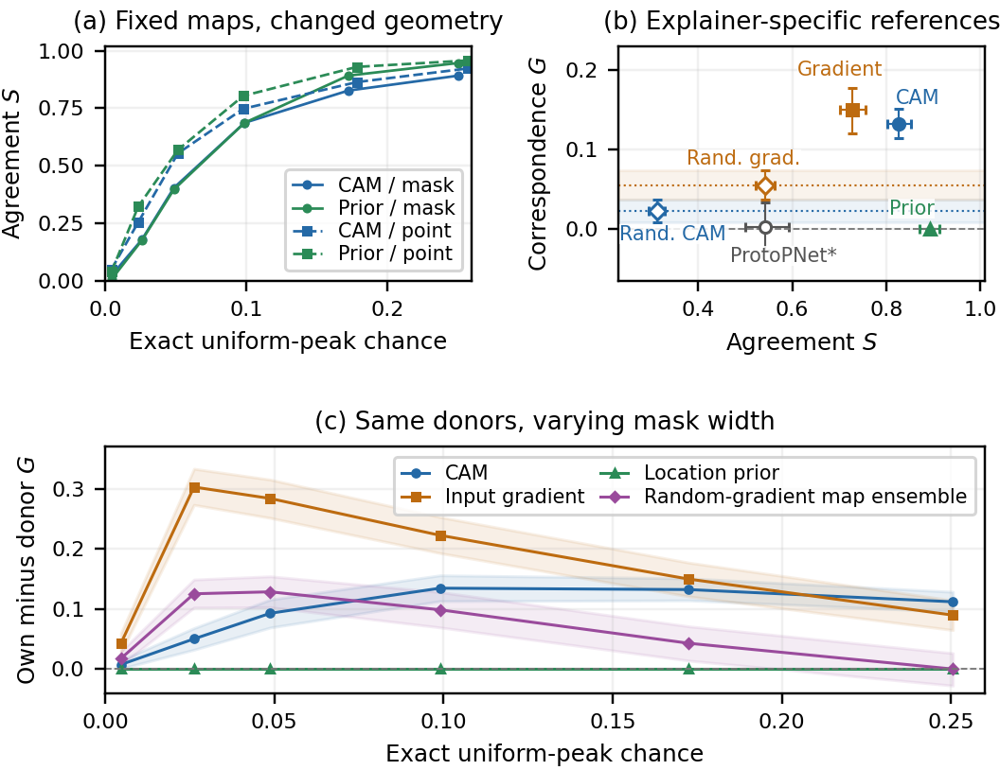
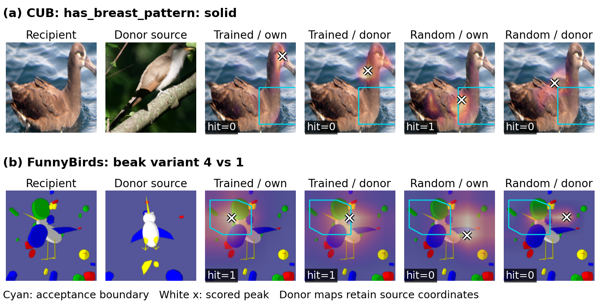

# Auditing Concept Localization

Code and numerical materials accompanying **Auditing Concept Localization:
Crossed Controls and Concept Eligibility**.

**Zhanghao Mei · Zuqiang Meng · Xuwei Tang**  
College of Computer, Electronics and Information, Guangxi University

## Paper version

The manuscript cites the fixed [paper snapshot `342aeb6`](https://github.com/meizhanghao/concept-localization-audit/tree/342aeb6cb5af87f37277051d156ec339248cda71),
also tagged `paper-v1`. Current `main` additionally contains portable independent
checkers added in `69037b1`; the 57 scientific inputs and reported estimates
are unchanged. The CEM and window analysis scripts already belong to the
paper snapshot. See [version scope and reproduction commands](docs/paper_snapshot.md).

## Overview

A concept map can hit the expected part without showing evidence specific to
its image or concept label. We audit localization scores by crossing two
controls: **own versus donor-image maps**, and **trained versus randomized
concept heads**. Every comparison keeps the recipient's target window fixed.



The audit reports four quantities:

| Quantity | Meaning |
|---|---|
| **S** | Spatial agreement: the map's peak hits the target acceptance region. |
| **G** | Image correspondence: own-map score minus donor-map score. |
| **G_rand** | The same correspondence contrast averaged across matched random heads. |
| **ΔG** | Excess correspondence: G minus G_rand. |

Separate positive image and head checks need not resolve their crossed
interaction. A second audit examines how concept-presence eligibility and
donor rules affect same-part label contrasts. See the
[protocol](docs/protocol.md) for definitions, aggregation and uncertainty.
The [worked audit card](docs/audit_card.md) shows a complete interpretation
of the frozen native Loc-CBM result.

## Quick start

Use **Python 3.10+** with NumPy. The reference environment is Python 3.10.8 /
NumPy 2.2.6. The complete numerical inputs are included in `data/` (about 25 MB).
The audits run on CPU; no dataset download or GPU is needed.

Download or clone this repository, then run from its root:

```bash
git clone https://github.com/meizhanghao/concept-localization-audit.git
cd concept-localization-audit
python -m pip install -r requirements-reproduce.txt
python run_audit.py
```

Expected terminal output:

```text
Inputs verified: 57 files
core: passed (maximum error ...)
concepts: passed (maximum error ...)
bridge: passed (maximum error ...)
extensions: passed (maximum error ...)
Results saved to .../results
```

All numerical differences must be at most **1e-12**. The runner validates input
SHA-256 hashes before scoring and exits with a nonzero status on failure.
Outputs include full-precision JSON reports, a CSV of the core scores, and a
combined verification report. See [reproduction instructions](docs/reproduction.md)
for individual audits and output fields.

## Included analyses

| Audit | Coverage |
|---|---|
| `core` | 36 localization score cases and 12 paired identity contrasts on FunnyBirds and CUB, including original/disjoint cohorts and eight frozen Loc-CBM adapter settings. |
| `concepts` | Primary same-part label contrast and a both-present conditional analysis, with paired intervals and random-head-adjusted contrasts. |
| `bridge` | CUB donor-rule comparison holding 133 ordered pairs, 7,081 recipient records, maps and macro weights fixed. Own/donor hits are recomputed from native peaks and keypoints. |
| `extensions` | Shared channel-permutation references and fixed-common-support same-species donors on native CUB maps. |

## Window sensitivity

The exploratory native CUB window sweep uses the same released peaks,
queries, donors, five Gaussian heads and paired image/head draws:

```bash
python sweep_cub_geometry.py
```

All four half-widths (16, 24, 36, 45) are reported. The original `h=45`
operating point is retained. A follow-up adds simultaneous bands, all six
paired width contrasts, and every anatomical/leave-one-group-out estimate:

```bash
python analyze_cub_robustness.py --input-dir data/core_audit/data --attribute-manifest data/core_audit/attribute_manifest.json --output-dir results/robustness
```

The follow-up is exploratory and reuses the same image/head draws. See the
[protocol and reporting checklist](docs/protocol.md) and
[complete sensitivity tables](docs/sensitivity_tables.md).
Portable independent checkers are included in the
[reproduction instructions](docs/reproduction.md#independent-numerical-checks).

## Additional published CEM

The CUB CEM released with [Raman et al., ICML 2024](https://proceedings.mlr.press/v235/raman24a.html)
is evaluated on the same 800 photos, 8,323 queries and 40 attributes. Its
preprocessing and Gaussian head reference follow its own architecture; the
result is not a cross-model ranking.

```bash
python audit_released_cem.py
```

The raw-image path supports both an eight-image example and the full cohort.
See [CEM reproduction instructions](docs/released_cem.md) for the author
checkpoint, input checks and CUDA command. Full regeneration reproduced all
49,938 scored peaks in the reference environment.

## Selected results

| Analysis | Estimate | 95% interval |
|---|---:|---:|
| Original CUB, native Loc-CBM, crossed ΔG | 0.039 | [−0.007, 0.084] |
| Disjoint CUB cohort, native Loc-CBM, crossed ΔG | 0.021 | [0.006, 0.037] |
| Same CUB cohort, released CEM, crossed ΔG | 0.039 | [−0.015, 0.087] |
| CUB primary same-part label contrast | 0.120 | [0.108, 0.133] |
| CUB both-present conditional label contrast | 0.003 | [−0.011, 0.019] |
| CUB fixed-recipient donor-rule difference | 0.026 | [0.024, 0.028] |

The primary and both-present contrasts use different conditional populations.
The bridge isolates the donor-rule effect on one fixed recipient set; it does
not decompose the original 0.120 contrast. An interval crossing zero remains
unresolved. Positive spatial correspondence does not establish semantic
correctness or causal faithfulness.

The CEM's fixed-head image-only interval is [0.028, 0.052]; its joint
image/head interval above remains unresolved. Native Loc-CBM's excess is
also uneven across parts: leaving out the eye group gives 0.016
[−0.0002, 0.0323]. These boundaries are retained in the analysis.



*Paper diagnostic on FunnyBirds. Panel (a) varies acceptance geometry for fixed
maps. Panel (b) separates spatial agreement from correspondence; its reference
bands are conditional intervals. Paired ΔG intervals, rather than band overlap,
determine above-reference evidence.*

## Project structure

```text
.
├── run_audit.py                 # Command-line entry point
├── audit_peaks.py               # New inputs; no expected-results dependency
├── regenerate_loccbm.py         # Small raw-image example with external data/weights
├── audit/                      # Scoring, aggregation and paired uncertainty
│   ├── core.py
│   ├── concepts.py
│   ├── bridge.py
│   ├── metrics.py
│   └── cli.py
├── data/                       # Frozen numerical inputs and expected results
│   ├── core_audit/
│   ├── concept_eligibility/
│   ├── donor_bridge/
│   ├── extensions/
│   └── checksums.json
├── assets/                     # Figures from the manuscript
├── docs/                       # Protocol, data schema and reproduction guide
├── tests/                      # Control-invariance and integrity checks
└── results/                    # Generated locally; excluded from Git
```

## Reproduction scope

This repository reproduces cached numerical audits. Core own/donor scores and
the donor bridge are recomputed from peaks and target geometry; concept-label
intervals use frozen per-query scores and resampling draws. Source-model
training, classification-quality experiments and upper-envelope optimization
are outside this package. An optional [eight-image Loc-CBM example](docs/regeneration.md)
regenerates native maps and peaks from user-provided original images and the
released checkpoint; it does not regenerate the entire experiment.

## Apply the audit to new maps

```bash
python audit_peaks.py --input examples/minimal/peaks.npz --config examples/minimal/config.json --output-dir results/minimal
```

The new-input API accepts peaks, recipient windows, eligibility IDs and donor
schedules, then writes JSON and Markdown audit cards. It supports keypoints or
binary masks, paired image/head intervals and exact chance without loading
expected results. See the [input schema](docs/new_inputs.md).



*CUB and FunnyBirds recipient/donor sources and trained/random × own/donor cells.
Cyan boundaries mark recipient acceptance regions; white crosses mark scored
peaks. Cases use fixed array order, without score-based selection. Each shows
one donor and one reference head, not population-average G.*

The [sensitivity report](docs/extensions.md) explains reference-family dependence
and what the same-species donor comparison does and does not establish.

The [data description](docs/data.md) documents coordinates, arrays and source
projects. [Protocol details](docs/protocol.md) distinguish conditional intervals,
joint image/head intervals and exploratory follow-ups.

## Citation

The accompanying manuscript is in preparation. Repository citation metadata
is provided in [CITATION.cff](CITATION.cff); publication details will be added
when available.

## Acknowledgments

This work uses derived evaluation records from
[CUB-200-2011](https://www.vision.caltech.edu/datasets/cub_200_2011/) and
[FunnyBirds](https://github.com/visinf/funnybirds), and builds on
[Loc-CBM](https://github.com/VIPL-VSU/Loc-CBM) and the
[ProtoCBM scorer](https://github.com/hqhQAQ/ProtoCBM). The additional CEM
uses the authors' release in [Concept-Learning](https://github.com/naveenr414/Concept-Learning).
The released NumPy scorer
implements the cached peak predicate independently. Dataset and model terms
remain those of their respective owners.

For questions about the code or protocol, contact **Zuqiang Meng**
([zqmeng@gxu.edu.cn](mailto:zqmeng@gxu.edu.cn)).
